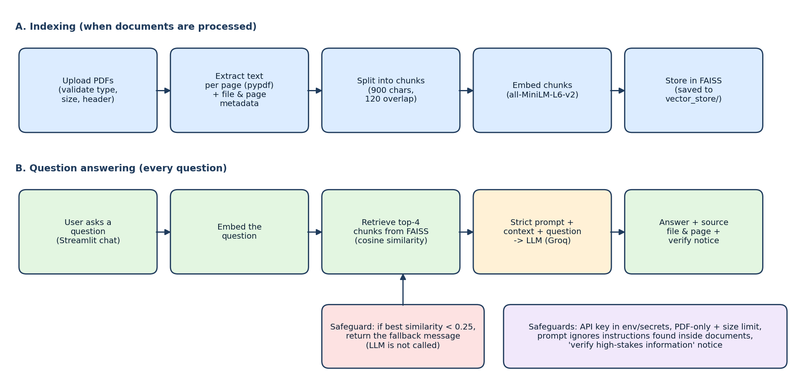

# Domain-Specific RAG Chatbot for PDF Question Answering

A Retrieval-Augmented Generation (RAG) chatbot that answers questions **only from uploaded PDF documents** and shows the **source file and page number** for every answer. If the answer is not in the documents, it refuses instead of inventing one.

*Unlox Major Project. Sample domain: company HR, IT and travel policies (3 sample PDFs in `documents/`).*

## Features
- Upload one or many PDFs (type, size and real PDF header validated), clear or replace documents
- Text extraction per page with file name and page number kept as metadata; empty pages skipped
- Chunking (900 characters, 120 overlap), embeddings with `all-MiniLM-L6-v2`, FAISS vector store saved locally
- Retrieval of the top 4 chunks, strict grounded prompt, fixed fallback message when nothing relevant is found
- Streamlit app: sidebar uploader, **Process Documents**, chat history, sources under each answer, **Clear Chat**
- Evaluation script with a 19-question test sheet (retrieval accuracy, answer correctness, refusal, response time)
- Safety: API key kept out of code, instructions hidden inside documents are ignored, "verify high-stakes information" notice

## Architecture


```
Upload PDFs -> extract text per page -> split into chunks -> embed -> store in FAISS
User question -> embed -> retrieve top chunks -> strict prompt + context -> LLM -> answer + source file and page
```

## Folder structure
```
domain_rag_chatbot/
|-- app.py                 Streamlit interface (Module 7)
|-- rag_pipeline.py        retrieval + grounded answer generation (Module 6)
|-- document_loader.py     validation, page extraction, chunking (Modules 1-3)
|-- vector_store.py        embeddings, FAISS, save/load, retrieval (Modules 4-5)
|-- prompt.py              strict prompt, fallback message, safety notice
|-- config.py              chunk size, top-k, model names, limits
|-- evaluate.py            runs the testing sheet
|-- requirements.txt  README.md  Dockerfile  .env.example  .gitignore
|-- documents/             sample PDFs (Employee_Handbook, IT_Security_Policy, Travel_and_Expense_Policy)
|-- vector_store/saved_index/   FAISS index is saved here
|-- tests/test_questions.csv    19 test questions (evaluation sheet)
|-- tests/test_pipeline.py      offline unit tests (pytest)
|-- docs/architecture.png
|-- REPORT.md              short project report + viva answers
```

## Setup (local)
```bash
git clone <your-repo-url> && cd domain_rag_chatbot
python -m venv .venv && source .venv/bin/activate      # Windows: .venv\Scripts\activate
pip install -r requirements.txt
cp .env.example .env                                   # then edit .env and add your Groq key
```
Get a free key at https://console.groq.com. **Never commit `.env`.**

## Run the app
```bash
streamlit run app.py
```
Upload PDFs in the sidebar and press **Process Documents** (or press **Use sample documents**), then ask questions. The first run downloads the embedding model (about 90 MB).

## Run in Google Colab
Open `Run_in_Colab.ipynb`, upload the project zip, add the `GROQ_API_KEY` secret (key icon on the left), and run the cells in order.

## Test and evaluate
```bash
pytest -q                              # offline unit tests, no key needed
python evaluate.py --retrieval-only    # retrieval accuracy only, no key needed
python evaluate.py                     # full test with the LLM; writes tests/evaluation_results.csv
```
`tests/test_questions.csv` has 11 answerable, 4 paraphrased and 4 unavailable questions. For your own documents, replace the rows with questions about them (expected file, page and a keyword that must appear in the answer).

## Deploy
**Streamlit Community Cloud:** push the repo to GitHub, create a new app at https://share.streamlit.io, choose `app.py`, and under *Advanced settings > Secrets* add `GROQ_API_KEY = "your_key"`. If the app runs out of memory, use Render or Docker below.

**Docker:**
```bash
docker build -t rag-chatbot .
docker run -p 8501:8501 -e GROQ_API_KEY=your_key rag-chatbot
```
**Render:** create a Web Service from the repo, build command `pip install -r requirements.txt`, start command `streamlit run app.py --server.port $PORT --server.address 0.0.0.0`, and add `GROQ_API_KEY` as an environment variable.

## Responsible AI and security
- API keys come from `.env`, Streamlit secrets or Colab secrets, never from code or GitHub
- Only `.pdf` files are accepted, with a size limit (20 MB) and header check
- Answers are limited to retrieved context; a fixed fallback message is used when the answer is missing
- If even the best chunk is below the similarity threshold the bot refuses **without calling the LLM**
- Instructions inside documents that try to change the chatbot rules are ignored
- The app tells users to verify high-stakes information; answers are never claimed to be automatically correct
- Do not upload confidential documents without permission

## Known limitations
- Scanned PDFs have no selectable text (OCR is an optional extension)
- Tables and multi-column layouts may extract poorly
- The LLM can still misread a correct passage, so retrieval accuracy and answer correctness are tested separately
- No conversation memory: each question is answered on its own

## Tech stack
Python, pypdf, LangChain text splitters, Sentence Transformers (`all-MiniLM-L6-v2`), FAISS, LangChain + Groq (`openai/gpt-oss-20b`), Streamlit, python-dotenv, Docker, Git/GitHub.
